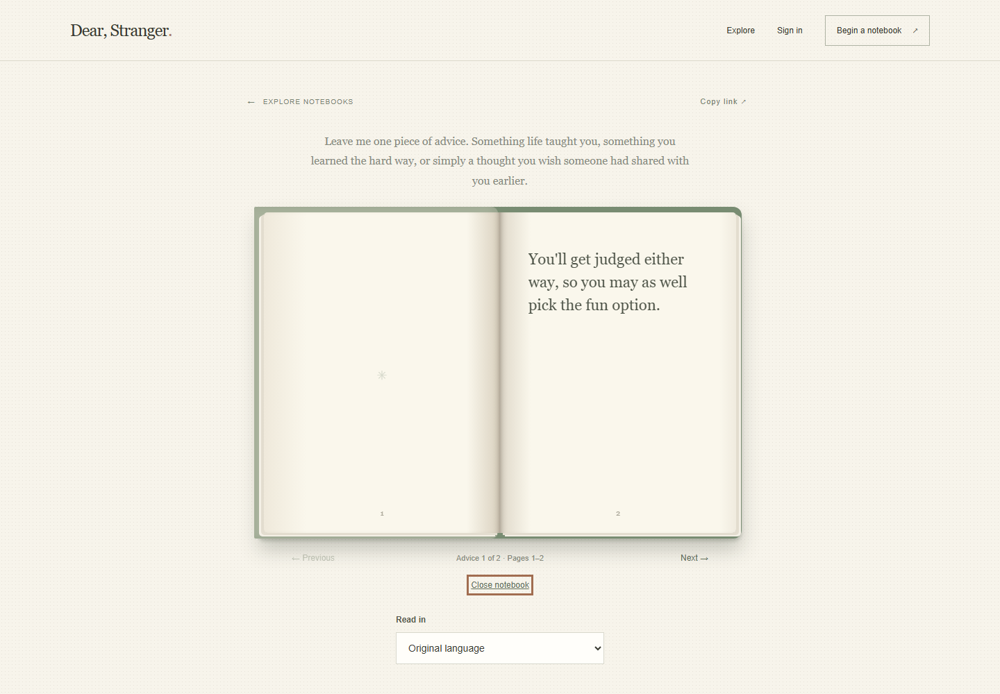
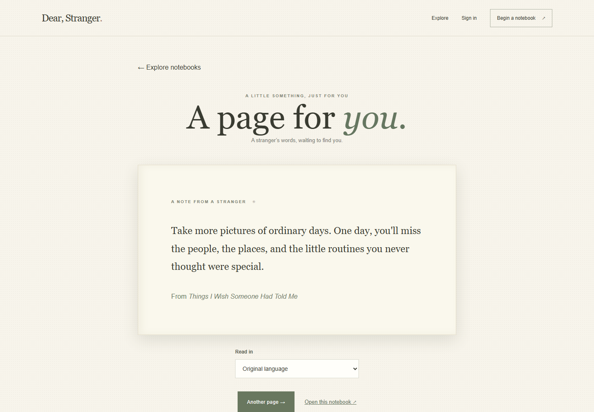

# Dear, Stranger. 📖

*A little advice. From someone you've never met.*

**[Try Dear, Stranger.](https://dear-stranger-omega.vercel.app)**

Dear, Stranger. is a multilingual anonymous advice notebook: a quiet place to share meaningful words without revealing a public identity, and to return to another person's perspective when you need it.

## The Problem

- Language barriers can limit whose experiences and advice we can access.
- Some people prefer sharing personal advice without publicly revealing their identity.
- Meaningful advice can get lost in conversations and social media feeds.

## The Solution

Create a personal notebook, share its link, and invite others to contribute advice by typing or speaking. Submissions pass through moderation; notebook owners can review and manage them. Readers can explore approved advice in a diary-style interface and request translations into supported languages.

Voice recordings are sent to Gnani for transcription, but the application does not intentionally store or publicly publish the original recordings. Contributors can edit their transcripts before submitting them.

## Features

- **Personal notebooks:** Create and manage a notebook with an automatically generated, shareable link.
- **Public discovery:** Explore and search notebooks marked public. Unlisted notebooks are accessible through their links but do not appear in Explore.
- **Anonymous contributions:** Visitors can submit written advice without an account or name.
- **Speech to text:** Record a short message for Gnani AI Prisma transcription, then edit the transcript before submission.
- **Multilingual reading:** Request translations into English, Hindi, Kannada, Tamil, Bengali, Gujarati, Malayalam, Marathi, Punjabi, or Telugu. Original text remains available.
- **Moderation and review:** Automated checks and Groq-assisted moderation process submissions; owners can approve, reject, or remove advice.
- **A diary to read:** Open a green hardcover and turn through spreads with a decorative left page and one advice entry on the right. Longer entries continue on subsequent spreads.
- **A Page for You:** Discover a randomly selected approved entry from a public notebook at `/a-page-for-you`.
- **Responsive interface:** Layouts adapt to smaller screens, and the reader respects reduced-motion preferences.

## How It Works

```text
Visitor → Type or speak advice → Gnani transcription (if spoken)
        → Edit transcript and submit → Moderation → Approved diary page
        → Translation on demand
```

Advice is initially saved as pending. Deterministic checks and, when configured, Groq-assisted moderation may approve, reject, or send it for review. The notebook owner can review submissions and make or change decisions. Only approved advice is shown to readers. Requested translations are also checked before being displayed and cached; if translation or its review is unavailable, the reader sees the original.

## Tech Stack

| Layer | Technologies and role |
| --- | --- |
| Frontend | React, React Router and Vite for the interface and client-side navigation; CSS and Tailwind tooling for styling |
| Backend | Node.js and Express for the API; Zod for validation, sessions and bcrypt for account authentication |
| Data | MongoDB and Mongoose for notebooks, advice, accounts and sessions, with `connect-mongo` for the session store |
| Speech | Gnani AI Prisma v3 speech-to-text |
| Translation | Google Cloud Translation Basic v2 |
| Moderation | Deterministic checks and Groq's OpenAI-compatible chat-completions API |
| Quality | ESLint, Vitest, Supertest and `mongodb-memory-server` |

## Screenshots

### Homepage


### Explore notebooks


### The notebook



### A Page for You


**Multilingual reading:** Screenshot to be added. During capture, the live reader showed the original text with a translation-unavailable message instead of a translated page.

## Local Setup

### Prerequisites

- A recent Node.js release with npm workspaces and built-in `fetch`, `FormData`, and `Blob` support.
- A running MongoDB instance, locally or on MongoDB Atlas.
- Optional provider credentials for speech, translation, and automated moderation. Microphone recording also requires a supported browser and HTTPS or localhost.

### Install and run

1. Clone and install dependencies from the repository root:

   ```bash
   git clone https://github.com/ARMedAndCurious/Dear-Stranger.git
   cd Dear-Stranger
   npm install
   ```

2. Copy `.env.example` to `.env` in the repository root. For example:

   ```bash
   # macOS / Linux
   cp .env.example .env
   ```

   ```powershell
   # Windows PowerShell
   Copy-Item .env.example .env
   ```

3. Start a local MongoDB server or create an Atlas database and use its connection string for `MONGODB_URI` in `.env`. Set `SESSION_SECRET` to a new random value of at least 32 characters and set `CLIENT_ORIGIN` to the frontend origin, normally `http://localhost:5173`. Add provider credentials if you want the corresponding features. Never commit `.env`.

4. Start both development servers:

   ```bash
   npm run dev
   ```

   Alternatively, run `npm run dev -w server` and `npm run dev -w client` in separate terminals.

5. Open `http://localhost:5173`. The API defaults to port `4000`; Vite proxies `/api` to `http://localhost:4000` in development. If the frontend uses another port, update `CLIENT_ORIGIN` accordingly. Changing the API port also requires updating the Vite proxy configuration.

## Environment Variables

The root `.env.example` lists the application's configuration. Values belong on the server, not in browser code or version control.

| Variable | Required? | Purpose |
| --- | --- | --- |
| `MONGODB_URI` | Yes | MongoDB connection string. |
| `SESSION_SECRET` | Yes | Session-signing secret, at least 32 characters. Generate your own random value. |
| `CLIENT_ORIGIN` | Yes | Allowed frontend origin for CORS. Must start with `https://` when `NODE_ENV=production`. |
| `PORT` | No | API port; defaults to `4000`. |
| `NODE_ENV` | No | Use `production` for production cookie and proxy behavior. |
| `GNANI_API_KEY` | For speech | Gnani API key. Without it, transcription is unavailable; typed submissions remain available. |
| `GOOGLE_TRANSLATE_API_KEY` | For new translations | Google Cloud Translation API key. Without it, new translations are unavailable; cached translations and original text can still be used. |
| `OPENAI_API_KEY` | For automated moderation | A **Groq API key**, not an OpenAI API key. |
| `OPENAI_MODERATION_MODEL` | For automated moderation | The configured Groq model identifier. Both moderation variables are required for automated model review. |

The `OPENAI_` names are retained for deployment compatibility; the moderation endpoint is Groq. When either moderation variable is missing or the service fails, submissions needing model review are marked for owner review rather than automatically approved. New translations also require an approved moderation result before they can be shown; without moderation, the original is shown instead.

## Architecture

```text
client/
  src/              React pages, diary reader, recording UI and styles
  test/             Frontend spread-layout tests
server/
  src/
    controllers/    Notebook and advice request handling
    models/         Mongoose data models
    routes/         Express API routes
    services/       Speech, translation, moderation and slug generation
    middleware/     Authentication, CSRF, validation and error handling
    validation/     Request schemas
  test/             API and service regression tests
.env.example        Environment variable template
```

The React client calls the Express API. The server handles authentication, validates requests, stores data in MongoDB, and communicates with external AI providers using server-side credentials. Notable routes include `/explore`, `/n/:slug`, and `/a-page-for-you` on the frontend, and `/api/notebooks`, `/api/speech/transcribe`, and `/api/advice/random` on the backend.

### Deployment

```text
Browser → Vercel frontend → same-origin /api rewrite → Render backend
                                                       → MongoDB Atlas
                                                       → Gnani, Google Cloud and Groq
```

The Vercel rewrite forwards `/api` requests to the Render backend at `https://dear-stranger-lou0.onrender.com`, while the browser uses the frontend's origin. This supports the application's existing session-cookie and CSRF flow. Other routes are rewritten to the frontend for client-side navigation.

## Security and Privacy

- Contributors do not need an account or a public name to submit advice. This is **not a guarantee of absolute anonymity**: avoid sharing personal information in submissions.
- API keys are used on the server. Account and notebook-owner actions use session authentication and ownership checks; state-changing API requests use CSRF protection.
- Advice is moderated before publication, although automated decisions can approve entries without a separate owner action. Owners can review and change decisions. Moderation is not infallible.
- Original voice recordings are not intentionally stored by the application or published in notebooks. Audio is sent to Gnani for transcription; providers and infrastructure may retain data or metadata under their own policies.
- Public notebooks are discoverable in Explore. Unlisted notebooks are not listed there, but anyone with their link can access them. New notebooks currently require choosing either visibility; the creation form defaults to unlisted.
- Text may be sent to external services for moderation or translation. Please review their privacy policies before submitting sensitive content.

## Testing and Limitations

From the repository root:

```bash
npm run build                    # Build the client
npm run lint                     # Lint the client
npm test                         # Run server Vitest suites
node --test client/test/spreads.test.js  # Run frontend spread-layout tests
```

The API integration suite uses `mongodb-memory-server` unless `TEST_MONGODB_URI` is supplied. Set that variable only to a **disposable test MongoDB instance**; the tests create and write to a randomly named test database.

- A previous test run on Windows ARM could not download the MongoDB test binary (HTTP 403), so the database-backed suite did not run in that environment. Use a compatible MongoDB binary or a disposable `TEST_MONGODB_URI` and rerun it.
- The application is deployed and the project owner reports successfully testing its core functionality manually. The frontend and backend discovery endpoint responded during this README update; an attempted Hindi translation returned the original with a translation-unavailable message. Provider availability, credentials, quotas and rate limits can affect AI features.
- Speech recordings are limited to short clips of up to approximately 30 seconds. Supported languages and provider quality may vary.
- Translation and moderation can fail or make mistakes. The application falls back to original text when a requested translation cannot be safely returned.
- Unlisted notebooks are link-accessible, not private or access-controlled. The current interface does not provide an owner-controlled visibility change after creation.

## Future Improvements

Potential next steps include accessibility refinements, stronger moderation and review tools, and additional language support. These are ideas, not current features.

## Internship Challenge

Dear, Stranger. was built for the **Great Indian AI Internship Challenge by Gnani AI**, using **Gnani AI Prisma** to turn Indian-language speech into editable text.

- 60-second demo video: *link to be added*
- LinkedIn project post: *link to be added*
